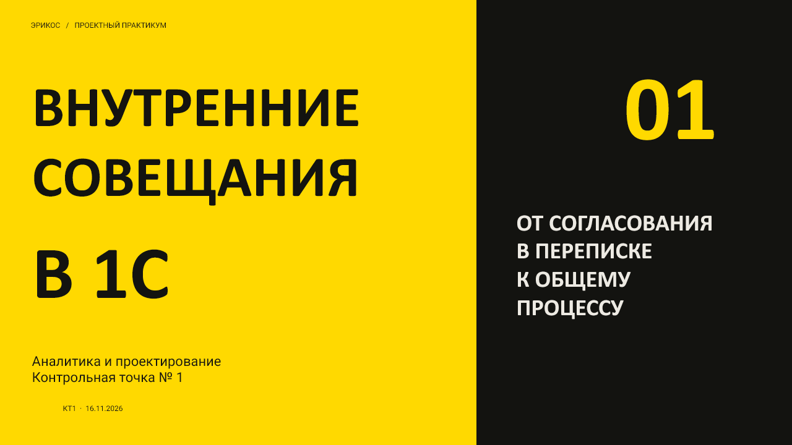

# Внутренние совещания в 1С

**Автоматизация процесса планирования и назначения сотрудникам компании внутренних совещаний**

Материалы команды для контрольной точки № 1 проектного практикума УрФУ. Заказчик — ООО «ЭРИКОС». Решение должно сократить ручное согласование встреч, дать организатору общую картину занятости и помочь управлять приглашениями и бронью ресурсов.

## Текущий результат

К 16 ноября 2026 года собраны материалы инициации и разобрано интервью с представителем заказчика от 13 ноября. В репозитории представлены обновлённые требования, модели процессов, сравнение вариантов, проект технического решения и сценарии приёмки.

**Этап: аналитика и проектирование.** Разработка и проверка прототипа в целевой конфигурации 1С ещё не выполнены. Версия конфигурации, тестовая среда и способ предоставления доступа уточняются с техническими специалистами заказчика. Документы от 16 ноября — проектные материалы для проверки командой и согласования с заказчиком.

## Быстрая навигация

| Материал | Содержание |
|---|---|
| [Презентация PDF](presentation/kt1-presentation.pdf) · [PowerPoint](presentation/kt1-presentation.pptx) | Основные результаты и план следующего этапа |
| [Итоги интервью](docs/09-interview-results.md) | Запрос заказчика и вопросы для уточнения |
| [Паспорт проекта](docs/01-project-brief.md) | Проблема, пользователи, цель и границы |
| [Требования](docs/02-requirements.md) | Требования из интервью и проверяемые условия |
| [AS-IS и TO-BE](docs/03-processes.md) | Обновлённые модели процессов и состояния |
| [Сравнение решений](docs/04-solution-comparison.md) | Ручной процесс, Документооборот и УТ + CRM |
| [Проект технического решения](docs/05-technical-design.md) | Проверка типовых возможностей и проект ТЗ |
| [Приёмочные сценарии](docs/06-acceptance.md) | Основной путь и исключения, ещё не выполненные в 1С |
| [Задачи команды](docs/07-team-backlog.md) | Ответственные, результаты и ссылки на Teamproject |
| [Источники и открытые вопросы](docs/08-sources-and-questions.md) | Основания требований и вопросы к заказчику |
| [Материалы инициации](artifacts/initiation/README.md) | Исходные схемы и протокол от 30 октября |

## Что меняется в процессе

Организатор выбирает участников, проверяет занятость, резервирует переговорную или ресурс видеовстречи и отправляет приглашения. Участники подтверждают участие или отказываются с пояснением. Организатор видит ответы в одном месте. При переносе система должна повторно проверить ресурс и актуализировать приглашения, при отмене — освободить бронь.

Сначала команда проверяет этот сценарий в типовых механизмах 1С:Документооборота. Перечень доработок формируется по обнаруженным разрывам, а не заранее.

## Команда

| Участник | Группа | Роль |
|---|---|---|
| Белов Андрей Дмитриевич | РИ-250921 | Тимлид |
| Люкова Софья Алексеевна | РИ-250921 | Аналитик |
| Кучеренко Егор Сергеевич | РИ-250921 | Разработчик |
| Мусиенко Матвей Валерьевич | РИ-250922 | Разработчик |
| Толошный Захар Павлович | РИ-250922 | Разработчик |

[Проект в Teamproject](https://teamproject.urfu.ru/#/89db7f1a-2d85-4f0c-9f06-b5b5b8ad9a85/about)

## Как использовать материалы

Документы можно читать прямо на GitHub. Диаграммы Mermaid отображаются внутри Markdown. Презентация доступна в PDF и PowerPoint. В документах отдельно отмечены факты из исходных материалов, предложения команды и вопросы, требующие проверки. Численные результаты внедрения пока не заявляются.
