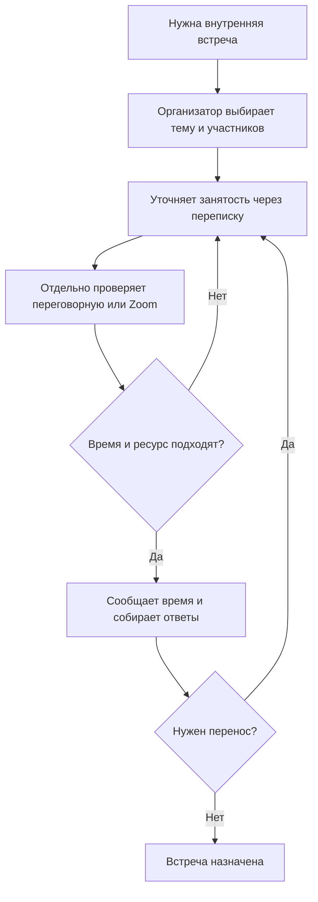
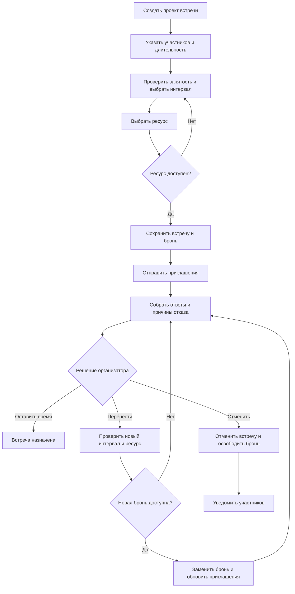
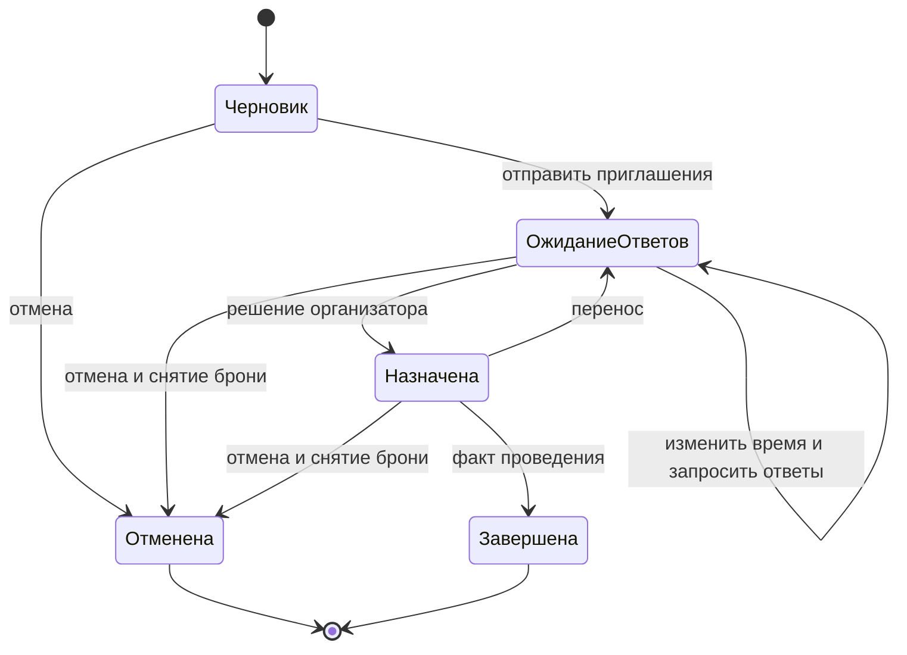

# Модели процессов AS IS и TO BE

Версия от 16 ноября 2026 года. Обновление рабочей модели после интервью от 13 ноября. Диаграммы описывают целевое поведение, а не уже работающую конфигурацию.

## Текущий процесс

Организатор вручную собирает доступность и ответы в переписке. Наличие календаря в компании не устраняет проблему: на интервью заказчик запросил единое место для просмотра занятости, приглашений и брони.

Точное число сообщений и среднее время согласования ещё не измерены.

## Целевой процесс

При неудаче переноса исходный вариант встречи должен оставаться понятным организатору. Конкретную последовательность записи и механизм защиты от параллельной брони необходимо проверить в типовой конфигурации.

## Состояния встречи

Это логические состояния проекта. Они не утверждают наличие объектов с такими именами в 1С. Учёт факта проведения нужен, если заказчик подтвердит соответствующую метрику. Условия, при которых встреча считается назначенной, ещё согласуются.

## Ответы участников

До ответа приглашение находится в состоянии «Не ответил». Затем участник выбирает «Принял» или «Отказался». При отказе предусмотрено пояснение. Существенный перенос формирует новую версию приглашения, поэтому старое подтверждение не должно незаметно подтверждать новое время.

## Отличия от версии инициации

Добавлены проверка занятости и ресурс встречи. Для переноса отдельно показана неудача резервирования нового ресурса. Отмена включает освобождение брони. Автоподбор времени сохраняется как требование с уточняемым приоритетом. Исходные PDF находятся в [архиве](../artifacts/initiation/README.md).
